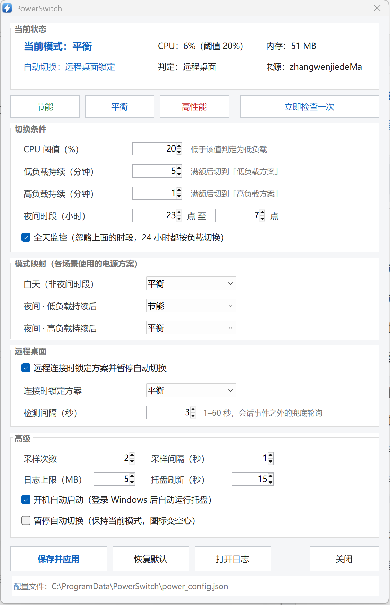

# PowerSwitch

> 按 CPU 负载和夜间时段，在「节能 / 平衡 / 高性能」之间自动切换电源计划。
> 远程桌面连进来时立刻锁定平衡方案，断开后自动交还给负载逻辑 —— 专为 24 小时挂机的 NAS 设计，用来压掉空载待机功耗。



C# · .NET 8 · WinForms · 单进程 · 单文件发布 · v1.2.0

---

## 它解决什么问题

NAS 常年开机，绝大部分时间是空载。Windows 默认的「平衡」方案在空载时并不会把频率压到最低，而手动切到「节能」又会在跑转码、同步、备份的时候拖慢机器。

PowerSwitch 做的就是这件事：**看 CPU 在干什么，替你把方案切过去**。

- 空载持续一段时间 → 切「节能」，功耗降下来
- 负载起来持续一小会儿 → 切「平衡」，任务不卡
- 你用远程桌面连进来干活 → 立刻锁「平衡」，断开后恢复自动切换

省的是 CPU 侧功耗（几瓦量级，取决于 CPU 和主板供电），不会让机械硬盘停转，也不控制风扇。

---

## 特性

| 特性 | 说明 |
|---|---|
| **单进程常驻** | 托盘、采样、切换、设置窗口都在一个 exe 里，常驻内存约 40–50 MB |
| **直接调 API** | `PowerSetActiveScheme` 一步到位，不 spawn `powercfg.exe`，没有子进程被连带杀死的问题 |
| **防抖状态机** | 低负载要持续 N 分钟才降档、高负载 N 分钟才升档，避免在阈值附近反复横跳 |
| **远程桌面联动** | 检测到 RDP 会话活动就锁定方案并暂停自动切换，断开即恢复 |
| **状态持久化** | 防抖计时写进 `power_switch_state.json`，进程重启不丢进度 |
| **配置热生效** | 设置窗口点「保存并应用」立即生效，不用重启、不用重装计划任务 |
| **暂停** | 30 分钟 / 1 小时 / 2 小时 / 4 小时 / 直到手动恢复 |
| **图标自愈** | 响应 `TaskbarCreated` + 盯 shell 进程 PID，explorer 重启后图标自动回来 |
| **进程自愈** | SYSTEM 看门狗每 15 秒检查，托盘被杀后自动拉回用户会话 |
| **高 DPI 友好** | `Application.SetHighDpiMode(SystemAware)` + 按真实 DPI 自行缩放，200% 缩放下文字不发虚 |
| **单文件部署** | 框架依赖 + `PublishSingleFile`，产物就是一个 exe；不写注册表、不装服务 |

---

## 决策逻辑

每次判断按下面的优先级来，命中就结束：

```
① 远程桌面连接中（PauseOnRemoteDesktop = true）
   → 锁定 RemoteDesktopMode，不做任何自动切换
② automation.paused 存在且未到期
   → 保持现状，什么都不做
③ 自动逻辑
   useLoadLogic = AllDayMonitor || 当前处于夜间时段
   ├─ false（白天且未开全天监控）→ 固定 DayMode
   └─ true → 按 CPU 负载走防抖状态机
        ├─ 低负载持续 LowLoadDuration 分钟 → NightLowLoadMode
        └─ 高负载持续 HighLoadDuration 分钟 → NightHighLoadMode
```

几个实现细节：

- **采样**：`GetSystemTimes` 取两次差值算总占用率，每次判断采 `SampleCount` 次、间隔 `SampleIntervalSec` 秒后取平均，避免瞬时尖峰误判
- **节拍**：引擎每 60 秒跑一轮；设置窗口里的「立即检查一次」会立刻插一轮
- **降档比升档慢**：默认低负载要持续 5 分钟才降，高负载 1 分钟就升 —— 宁可多耗一点，也别让任务卡在节能档
- **优先级说明**：远程桌面**压过**手动暂停。远程操作时被降到节能档会让整台机器明显卡顿，这个约束比「保持手动选择」更强；暂停标志本身不会被清掉，断开后照旧生效

---

## 远程桌面联动

判定依据不是「本机有没有 mstsc 进程」（那只说明你在往外连），而是直接问终端服务：枚举所有会话，**状态 = 活动 且 客户端协议 = RDP** 才算有外部连入。这样本机物理登录、控制台会话都不会误触发。

两条检测通道并行，互为兜底：

| 通道 | 延迟 | 作用 |
|---|---|---|
| `WTSRegisterSessionNotification` | ~0.4 秒 | 系统在会话变化时主动推消息，负责「立即」 |
| 定时轮询（默认 3 秒） | ≤3 秒 | 进程启动前就已连上、消息丢失、跨会话通知不到时兜底 |

日志里能看到完整过程：

```
15:55:06 远程桌面状态变化: 已连接 Administrator@zhangwenjiedeMa（会话 3）
15:55:06 检测到远程桌面连接：... 立即切换到 平衡 并暂停自动切换
15:58:09 远程桌面连接中 - 强制切换到 平衡        ← 期间被手动改档也会拉回来
15:58:30 远程桌面状态变化: 已断开
15:58:31 远程桌面已断开，恢复自动切换
```

断开后不会立刻降档，而是**清空计时重新计**：远程刚结束，机器往往还在收尾，立刻降到节能反而拖慢它。

---

## 安装

**要求**：Windows 10 1809+ / 11，**已装 .NET 8 Desktop Runtime**，首次安装需要管理员权限。

运行时是框架依赖发布的前提。先确认：

```powershell
dotnet --list-runtimes | Select-String 'WindowsDesktop'
# 期望看到 Microsoft.WindowsDesktop.App 8.0.x
```

没有的话装一个（约 55 MB，装完无需重启）：

```powershell
winget install Microsoft.DotNet.DesktopRuntime.8
# 或手动下载：https://dotnet.microsoft.com/download/dotnet/8.0/runtime
```

> 看门狗以 SYSTEM 身份运行，所以运行时必须装在**机器级**位置（`C:\Program Files\dotnet`），
> 用户级安装（`%LOCALAPPDATA%\Microsoft\dotnet`）对 SYSTEM 不可见，会导致看门狗启动失败。

```powershell
# 1. 两个 exe 放到同一目录，推荐 C:\ProgramData\PowerSwitch\
#    PowerSwitch.exe          —— 托盘主程序
#    PowerSwitchWatchdog.exe  —— SYSTEM 看门狗

# 2. 注册看门狗（SYSTEM 身份，开机自启 + 每 5 分钟兜底）
$dir = "C:\ProgramData\PowerSwitch"
$exe = Join-Path $dir "PowerSwitchWatchdog.exe"
$act = New-ScheduledTaskAction -Execute $exe -Argument "--dir `"$dir`"" -WorkingDirectory $dir
$prn = New-ScheduledTaskPrincipal -UserId 'SYSTEM' -LogonType ServiceAccount -RunLevel Highest
$set = New-ScheduledTaskSettingsSet -MultipleInstances IgnoreNew `
       -AllowStartIfOnBatteries -DontStopIfGoingOnBatteries `
       -StartWhenAvailable -ExecutionTimeLimit ([TimeSpan]::Zero) `
       -RestartCount 3 -RestartInterval (New-TimeSpan -Minutes 1)
Register-ScheduledTask -TaskName 'PowerSwitchWatchdog' -Action $act `
    -Trigger (New-ScheduledTaskTrigger -AtStartup) -Settings $set -Principal $prn -Force

# 3. 启动看门狗（它会把托盘拉起来）
Start-ScheduledTask -TaskName 'PowerSwitchWatchdog'
```

启动后托盘出现图标，双击即可打开设置。也可以直接双击 `PowerSwitch.exe`。

**登录自启（可选，只是让图标出现得更快）**：设置窗口里勾「开机自动启动」即可，它会在启动文件夹写一个 `PowerSwitch.vbs`，勾掉就删掉，不碰注册表。没有它也能用 —— 看门狗 15 秒内会把托盘拉起来。

程序用全局互斥量 `Global\PowerSwitchTray` 保证只有一个实例，两条路同时启动也只会有一个图标。

---

## 设置窗口

顶部是**实时状态**：当前方案、CPU、内存、自动切换是否在跑、判定结果、还要多久降档。下面按「切换条件 / 模式映射 / 远程桌面 / 高级」分成四组。

- 状态条每 2 秒刷新，能直接看到「低负载 3.5/5 分 → 节能」这种进度，不用翻日志
- 「节能 / 平衡 / 高性能」是手动接管，点了立刻生效；但远程桌面锁定期间会被拉回锁定方案
- 「暂停自动切换」勾上后托盘图标变空心，自动逻辑停摆，手动切换仍然有效

---

## 配置

配置文件 `power_config.json` 放在 exe 同目录，格式与旧 PowerShell 版完全兼容。

| 字段 | 默认 | 说明 |
|---|---|---|
| `NightStartHour` | `23` | 夜间开始（24 小时制，0–23） |
| `NightEndHour` | `7` | 夜间结束；跨零点（如 23 → 7）也支持 |
| `AllDayMonitor` | `true` | `true` = 忽略夜间时段，全天按负载切换 |
| `CpuThreshold` | `20` | CPU 阈值（%），低于此值算低负载 |
| `LowLoadDuration` | `5` | 低负载持续多少分钟才降档 |
| `HighLoadDuration` | `1` | 高负载持续多少分钟才升档 |
| `SampleCount` | `2` | 每次判断采几次样 |
| `SampleIntervalSec` | `5` | 采样间隔（秒） |
| `MaxLogSizeMB` | `5` | 日志超过该大小即轮转为 `.1` |
| `TrayRefreshSec` | `15` | 托盘图标与提示的刷新间隔（秒） |
| `DayMode` | `Balanced` | 白天固定方案（仅 `AllDayMonitor=false` 时生效） |
| `NightLowLoadMode` | `PowerSaver` | 低负载目标方案 |
| `NightHighLoadMode` | `Balanced` | 高负载目标方案 |
| `PauseOnRemoteDesktop` | `true` | 远程桌面连接时锁定方案并暂停自动切换 |
| `RemoteDesktopMode` | `Balanced` | 远程桌面期间锁定到哪个方案 |
| `RdpPollSeconds` | `3` | 远程桌面状态轮询间隔（秒，1–60） |

**电源方案 GUID**（系统固定值，不随语言变化）：

| 键名 | GUID |
|---|---|
| `PowerSaver` | `a1841308-3541-4fab-bc81-f71556f20b4a` |
| `Balanced` | `381b4222-f694-41f0-9685-ff5bb260df2e` |
| `HighPerformance` | `8c5e7fda-e8bf-4a96-9a85-a6e23a8c635c` |
| `UltimatePerformance` | `e9a42b02-d5df-448d-aa00-03f14749eb61` |

---

## 命令行

| 参数 | 程序 | 说明 |
|---|---|---|
| 无参数 | PowerSwitch | 启动托盘（已有实例时静默退出） |
| `--settings` | PowerSwitch | 启动并直接弹出设置窗口 |
| `--once` | Watchdog | 只检查一次就退出（调试用） |
| `--dir <路径>` | Watchdog | 指定主程序所在目录，默认与看门狗同目录 |

**轻量控制通道**：在运行目录放一个 `open_settings.request` 文件，运行中的实例会在一个刷新周期内打开设置窗口并删掉该文件。适合脚本、快捷方式或远程操作 —— 不必去找托盘图标。

---

## 运行时文件

都在 exe 同目录，已被 `.gitignore` 排除：

| 文件 | 作用 |
|---|---|
| `power_config.json` | 配置 |
| `power_switch.log` / `.log.1` | 主日志，超过 `MaxLogSizeMB` 自动轮转 |
| `power_switch_state.json` | 防抖计时与当前方案，重启不丢进度 |
| `automation.paused` | 暂停标志，存在即暂停；内容含到期时间 |
| `watchdog.log` | 看门狗日志 |
| `tray.stopped` | 用户主动退出的标记，30 分钟内不再拉起 |
| `open_settings.request` | 控制请求（临时文件） |

---

## 构建

需要 **.NET 8 SDK**（不是运行时），不需要 Visual Studio：

```powershell
powershell -ExecutionPolicy Bypass -File build\build.ps1
```

产物在 `build\out\`：

- `PowerSwitch.exe`（约 1.15 MB）
- `PowerSwitchWatchdog.exe`（约 165 KB）

脚本内部就是两次 `dotnet publish -c Release`，发布配置写在各自的 csproj 里：

| 设置 | 值 | 效果 |
|---|---|---|
| `TargetFramework` | `net8.0-windows` | 需要 Windows 桌面运行时 |
| `SelfContained` | `false` | 不打包运行时，体积保持在 1 MB 级 |
| `PublishSingleFile` | `true` | 产物是单个 exe，没有一堆 dll 要跟着拷 |
| `RuntimeIdentifier` | `win-x64` | 单文件发布必须指定 RID |

两个工程共 3.6k 行，编译零告警。

**关于 `app.manifest`**：它只保留视觉样式（Common-Controls v6）和 `supportedOS` 声明。高 DPI **不再**由清单声明 —— .NET 6+ 的 WinForms 要求走 `Application.SetHighDpiMode(HighDpiMode.SystemAware)`（在 `Program.Main` 第一行），清单和 API 同时设置会互相覆盖并触发 `WFAC010`。

**语言版本**：C# 12（`net8.0-windows` 默认）。代码仍保持 C# 5 兼容写法（无字符串插值、无 `?.`、无表达式体成员），所以在旧编译器上也能编 —— 这是从 Framework 版迁移时保留的风格，不影响功能。

---

## 故障排查

**托盘图标不见了**

```powershell
Get-Process PowerSwitch | Select-Object Id, SessionId, @{n='MB';e={[int]($_.WorkingSet64/1MB)}}
```

- **进程在、图标没了** → explorer 重启过。本版会自动恢复；若没恢复，看日志里有没有 `重新注册托盘图标`
- **进程也没了** → 看 `watchdog.log`，正常应该 15 秒内出现 `已启动 ... pid=`。若没有，检查任务状态：

```powershell
Get-ScheduledTaskInfo -TaskName PowerSwitchWatchdog | Select-Object LastRunTime, LastTaskResult
```

`LastTaskResult = 267009`（`0x41301`）表示任务正在运行，正常。

**设置了「退出」但图标又回来了**

`tray.stopped` 标记只挡 30 分钟，且重新手动启动会清掉它。要长期停用，请禁用计划任务：

```powershell
Disable-ScheduledTask -TaskName PowerSwitchWatchdog
```

**设置窗口打不开**

```powershell
Set-Content C:\ProgramData\PowerSwitch\open_settings.request -Value go
```

**看门狗拉不起进程**

`watchdog.log` 里若出现 `WTSQueryUserToken 失败` 或 `CreateProcessAsUser 失败 (1314)`，说明 SYSTEM 缺少 `SeTcbPrivilege`，或目标会话没有登录用户。用 `quser` 确认会话状态。

**日志乱码**

PowerShell 5.1 的 `Get-Content` 默认按 ANSI 解码，而日志是 UTF-8：

```powershell
Get-Content C:\ProgramData\PowerSwitch\power_switch.log -Tail 30 -Encoding UTF8
```

---

## 目录结构

```
PowerSwitch/
├── src/                          # 主程序
│   ├── Program.cs                # 入口：单实例互斥量、全局异常兜底
│   ├── TrayApp.cs                # 托盘、菜单、TaskbarCreated 恢复
│   ├── PowerEngine.cs            # 采样 + 防抖状态机 + 远程桌面覆盖
│   ├── PowerNative.cs            # P/Invoke：电源 API、CPU 采样
│   ├── PowerScheme.cs            # 方案 GUID 与名称映射
│   ├── RdpMonitor.cs             # 远程桌面会话检测（WTS API + 会话变更通知）
│   ├── AppIcon.cs                # 图标统一入口（托盘与窗口共用）
│   ├── AppConfig.cs              # 配置模型 + 扁平 JSON 读写
│   ├── SettingsForm.cs           # 设置窗口（分组卡片 + 实时状态条）
│   ├── Logger.cs                 # 日志与轮转
│   ├── Paths.cs                  # 路径常量
│   ├── app.manifest              # 视觉样式 + supportedOS（DPI 改由 API 设置）
│   ├── PowerSwitch.csproj        # net8.0-windows，框架依赖 + 单文件
│   └── icons/                    # 5 个托盘图标（嵌入资源）
├── watchdog/
│   ├── Program.cs                # SYSTEM 看门狗
│   └── PowerSwitchWatchdog.csproj
├── build/
│   └── build.ps1                 # 两次 dotnet publish
├── docs/images/
└── LICENSE                       # MIT
```

---

## 卸载

```powershell
Stop-ScheduledTask -TaskName PowerSwitchWatchdog
Unregister-ScheduledTask -TaskName PowerSwitchWatchdog -Confirm:$false
Get-Process PowerSwitch* | Stop-Process -Force
Remove-Item "$env:APPDATA\Microsoft\Windows\Start Menu\Programs\Startup\PowerSwitch.vbs" -ErrorAction SilentlyContinue
Remove-Item C:\ProgramData\PowerSwitch -Recurse -Force
```

不写注册表、不装服务、不注入系统目录，删干净即恢复原状。

---

## 已知限制

- 切换的是**整个电源方案**，会连带应用该方案下的「硬盘关闭时间」。若各方案这一项配置不同，硬盘休眠行为会跟着变 —— 长期挂机建议先把各方案的硬盘超时统一
- 省的是 **CPU 侧功耗**，量级几瓦；不会让机械硬盘停转，也不控制风扇曲线
- 看门狗需要 SYSTEM 权限注册计划任务，首次安装需要管理员
- 远程桌面检测基于「会话协议类型」，Hyper-V 增强会话模式也会被识别为 RDP（通常正是想要的行为）
- 兼容性：Windows 11 ✅ 已实测（24H2）、Windows 10 1809+ ✅、Server 2019/2022 ✅ 理论可用、Windows 7/8.1 ❌（.NET 8 已不支持）
- 需要 .NET 8 Desktop Runtime。若目标机完全不能装运行时（比如某些离线环境），请改用 git 历史里的 `v1.1.2` 标签 —— 那一版是 .NET Framework 4.0 编译的，Windows 自带即可运行

---

## 版本与运行时

| 版本 | 目标运行时 | exe 体积 | 目标机依赖 |
|---|---|---|---|
| `v1.2.0`（当前） | .NET 8（框架依赖 + 单文件） | 1.15 MB | 需装 Desktop Runtime 8.x |
| [`v1.1.2`](https://github.com/Chaconez/PowerSwitch.NET/tree/v1.1.2) | .NET Framework 4.0 | 866 KB | 无，Windows 自带 |

功能上两版等价，差别只在运行时。之所以迁到 .NET 8：能直接用现代 C#、`dotnet publish` 一条命令出单文件、不用再维护手写 `csc.exe` 调用链。代价是目标机多了 55 MB 运行时这一前提 —— 如果这个前提不能接受，用 `v1.1.2` 就好。

---

## 相关

- [PowerSwitch（PowerShell 版）](https://github.com/Chaconez/PowerSwitch) —— 初版实现，功能等价，本仓库是为解决其托盘图标反复丢失而做的 C# 重写

本项目以 [MIT 协议](LICENSE) 开源。
